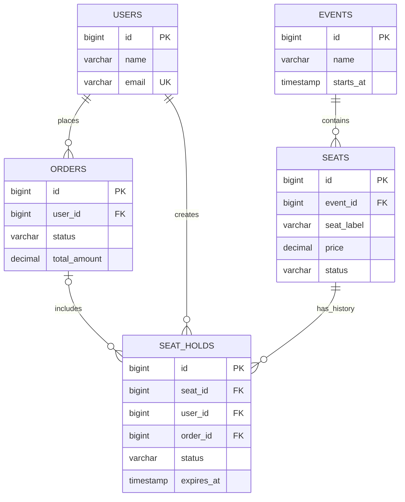
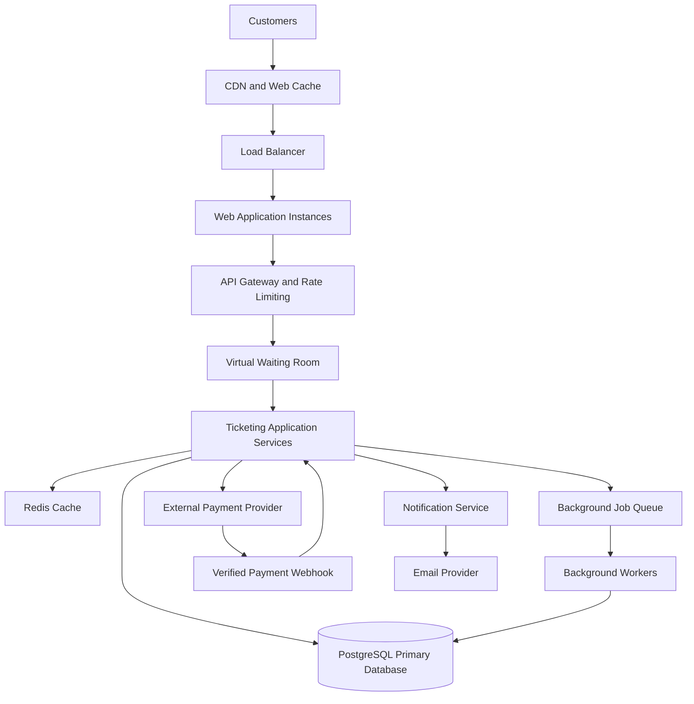

# TicketHub: System Design

## 1. Requirements

### 1.1 Functional Requirements

TicketHub is an online ticketing platform where users can discover events, select seats, purchase tickets, and view their bookings.

The system must support the following features:

1. **User accounts:** Users can register, sign in, and manage their accounts.
2. **Event browsing:** Users can browse upcoming concerts and events, search by name, filter by date or category, and view event details.
3. **Seat selection:** Users can view available, held, and sold seats for an event.
4. **Seat reservation:** Users can temporarily hold available seats while completing checkout.
5. **Payment processing:** Users can pay for reserved seats through a payment provider.
6. **Order management:** Users can view their orders and payment status.
7. **Ticket generation:** After successful payment, the system generates tickets linked to the purchased seats.
8. **Reservation expiration:** Unpaid seat holds expire automatically, allowing other users to purchase those seats.
9. **Notifications:** Users receive booking confirmations and their ticket details after successful payment.
10. **Order history:** Users can view their previous purchases and retrieve their tickets.

### 1.2 Non-Functional Requirements

**Performance**

* Event listings and event details should load within 2 seconds under normal conditions.
* Seat availability should be returned quickly without repeatedly querying the database for every individual seat.
* The system should remain responsive during high-demand ticket sales.

**Correctness and consistency**

* A seat must never be sold to two different customers.
* Payment must be verified before an order is marked as paid.
* An order must not issue duplicate tickets when a payment notification is received more than once.
* Seat availability, reservations, and payments must be represented accurately.
* Failed transactions must not leave seats permanently reserved.

**Fairness**

* Users should have a reasonable opportunity to enter the purchase process.
* A high-demand event should use a waiting room or queue to control how many users enter checkout simultaneously.
* The queue should follow a transparent ordering policy, such as first-in, first-out, with clearly communicated rules.
* The system should enforce the same seat-hold duration for eligible users.
* Rate limiting should reduce automated abuse and excessive requests.

**Availability and reliability**

* The platform should continue serving event information even when the purchase system is under heavy load.
* Application instances should be replaceable without losing confirmed orders.
* Failed payment requests should be recoverable without creating duplicate charges or tickets.

**Security**

* Authentication is required for seat reservations, checkout, and access to personal tickets.
* Users must only access their own orders and tickets.
* Payment card details should be handled by a trusted payment provider rather than stored directly by TicketHub.
* API endpoints must validate input and enforce authorization.
* Sensitive data must be encrypted in transit.

**Scalability**

* The application should support growth beyond its current 2 million registered users.
* Additional application instances should be deployable when traffic increases.
* Expensive database operations should be protected from sudden spikes in requests.

---

## 2. Traffic and Capacity Estimates

TicketHub has 2 million registered users.

The normal daily traffic consists of 50,000 visitors, with each visitor viewing an average of 10 pages. Approximately 5,000 tickets are sold per day.

During a popular concert sale, 200,000 people attempt to purchase 20,000 seats within the first 10 minutes.

### 2.1 Normal Traffic

**Page views per day**

50,000 visitors × 10 pages per visitor = 500,000 page views per day.

**Average page requests per second**

500,000 ÷ 86,400 seconds = approximately 5.8 page requests per second.

**Average ticket sales per second**

5,000 tickets ÷ 86,400 seconds = approximately 0.058 tickets per second.

This is an average of approximately 208 tickets per hour.

These averages provide a baseline. Actual traffic will fluctuate throughout the day, so production capacity must also account for normal peak periods.

### 2.2 Popular Concert Sale

**Purchase attempts per second**

200,000 people ÷ 600 seconds = approximately 333 purchase attempts per second.

**Tickets available per second**

20,000 seats ÷ 600 seconds = approximately 33 seats per second.

**Demand compared with available seats**

200,000 people are competing for 20,000 seats.

200,000 ÷ 20,000 = 10.

There are 10 potential buyers for every available seat.

**Expected outcome**

Only 10% of the people attempting to buy tickets can receive one if each person purchases one seat and all 20,000 seats are sold.

The system must therefore manage competition for limited inventory, not simply process requests as quickly as possible.

### 2.3 Comparison

| Metric                        | Normal Traffic                             | Popular Concert Sale                                                                            |
| ----------------------------- | ------------------------------------------ | ----------------------------------------------------------------------------------------------- |
| Visitors or purchase attempts | 50,000 visitors per day                    | 200,000 purchase attempts in 10 minutes                                                         |
| Page views                    | 500,000 per day                            | Concentrated around the event sale                                                              |
| Average page requests         | Approximately 5.8 per second               | Depends on page views and retries; purchase attempts alone average approximately 333 per second |
| Tickets available or sold     | Approximately 5,000 tickets sold per day   | 20,000 seats available                                                                          |
| Main challenge                | Efficient everyday browsing and purchasing | Sudden demand, inventory contention, fairness, and database protection                          |

The big sale concentrates substantial demand into a very short period. The average purchase-attempt rate of approximately 333 per second is much higher than the normal average ticket-sales rate of approximately 0.058 per second.

These rates measure different activities, so they should not be treated as directly equivalent workloads. The big-sale figure measures attempts, not successful sales.

The architecture should use caching, a virtual waiting room, rate limiting, and controlled access to the reservation system to manage this spike.

---

## 3. API Design

TicketHub will expose a REST API using JSON for request and response bodies.

Authenticated endpoints will require a valid access token. The API will validate input, enforce authorization, and return appropriate HTTP status codes.

### Endpoint 1: Browse Events

**Request**

`GET /api/v1/events?page=1&limit=20&category=concert`

**Purpose**

Returns a paginated list of upcoming events. Users can filter events by category and search for events by name or date.

**Successful response: 200 OK**

```json
{
  "events": [
    {
      "id": 101,
      "name": "Summer Music Festival",
      "category": "concert",
      "venue": "City Arena",
      "starts_at": "2027-01-15T18:00:00Z"
    }
  ],
  "page": 1,
  "limit": 20,
  "total": 1
}
```

### Endpoint 2: View Event Seats

**Request**

`GET /api/v1/events/101/seats`

**Purpose**

Returns seat identifiers, prices, and current availability for a particular event.

The response can be cached briefly, but cached availability is informational only. The reservation operation must always verify the current database state.

**Successful response: 200 OK**

```json
{
  "event_id": 101,
  "seats": [
    {
      "id": 501,
      "label": "A1",
      "price": 2500,
      "status": "available"
    },
    {
      "id": 502,
      "label": "A2",
      "price": 2500,
      "status": "held"
    }
  ]
}
```

### Endpoint 3: Hold Seats

**Request**

`POST /api/v1/holds`

**Purpose**

Attempts to reserve one or more available seats temporarily while a user completes checkout.

The request must include an idempotency key so that retrying the same operation does not create duplicate holds.

**Request body**

```json
{
  "event_id": 101,
  "seat_ids": [501],
  "idempotency_key": "hold-request-abc123"
}
```

**Successful response: 201 Created**

```json
{
  "hold_id": "hold-9001",
  "event_id": 101,
  "seat_ids": [501],
  "status": "active",
  "expires_at": "2027-01-15T17:05:00Z"
}
```

The example assumes a five-minute hold period.

If another customer has already reserved the seat, the API returns `409 Conflict`. It must not create a second active hold for the same seat.

### Endpoint 4: Create an Order and Initiate Payment

**Request**

`POST /api/v1/orders`

**Purpose**

Creates an order from a valid seat hold and initiates payment through the configured payment provider.

The server calculates the total price using trusted database records rather than accepting a total supplied by the client.

**Request body**

```json
{
  "hold_id": "hold-9001",
  "idempotency_key": "order-request-xyz789",
  "payment_method": "provider_checkout"
}
```

**Successful response: 201 Created**

```json
{
  "order_id": "order-7001",
  "status": "pending_payment",
  "amount": 2500,
  "currency": "KES",
  "payment_url": "https://payment-provider.example/checkout/session"
}
```

The URL above is illustrative, not a real payment link.

The payment provider processes the payment and notifies TicketHub of the result through a verified webhook or another trusted confirmation mechanism.

### Endpoint 5: View an Order

**Request**

`GET /api/v1/orders/order-7001`

**Purpose**

Returns the status and details of an order belonging to the authenticated user.

**Successful response: 200 OK**

```json
{
  "order_id": "order-7001",
  "status": "paid",
  "amount": 2500,
  "currency": "KES",
  "tickets": [
    {
      "ticket_id": "ticket-3001",
      "seat_id": 501,
      "status": "valid"
    }
  ]
}
```

A user cannot retrieve another customer's order by guessing its identifier.

### Endpoint 6: View My Tickets

**Request**

`GET /api/v1/me/tickets`

**Purpose**

Returns tickets belonging to the authenticated user, including their event details, seat assignments, and ticket status.

**Successful response: 200 OK**

```json
{
  "tickets": [
    {
      "ticket_id": "ticket-3001",
      "event_name": "Summer Music Festival",
      "seat_label": "A1",
      "status": "valid"
    }
  ]
}
```

### API Error Handling

The API should use appropriate status codes:

* `400 Bad Request`: Invalid request data.
* `401 Unauthorized`: Missing or invalid authentication.
* `403 Forbidden`: The user is not permitted to perform the operation.
* `404 Not Found`: The requested event, seat, or order does not exist.
* `409 Conflict`: A seat is already held or sold, or a reservation is no longer valid.
* `429 Too Many Requests`: Rate limit or queue admission limit exceeded.
* `500 Internal Server Error`: Unexpected server failure.

Payment initiation and webhook processing must be idempotent. Repeated requests for the same operation should not create duplicate orders, charges, or tickets.

---

## 4. Data Model

TicketHub will use a relational database such as PostgreSQL because purchases require transactions, referential integrity, and uniqueness constraints.

The following five tables represent the core design.

### 4.1 Users

Stores registered customer information.

| Column        | Type         | Constraints      |
| ------------- | ------------ | ---------------- |
| id            | BIGINT       | Primary key      |
| name          | VARCHAR(150) | Not null         |
| email         | VARCHAR(255) | Unique, not null |
| password_hash | VARCHAR(255) | Not null         |
| created_at    | TIMESTAMP    | Not null         |

Passwords are stored as secure password hashes, never as plain text.

### 4.2 Events

Stores information about concerts and other events.

| Column        | Type         | Constraints |
| ------------- | ------------ | ----------- |
| id            | BIGINT       | Primary key |
| name          | VARCHAR(255) | Not null    |
| description   | TEXT         | Optional    |
| venue         | VARCHAR(255) | Not null    |
| starts_at     | TIMESTAMP    | Not null    |
| sales_open_at | TIMESTAMP    | Not null    |
| status        | VARCHAR(30)  | Not null    |
| created_at    | TIMESTAMP    | Not null    |

An event can have many seats and many orders.

### 4.3 Seats

Stores the seat inventory for each event.

| Column     | Type          | Constraints                        |
| ---------- | ------------- | ---------------------------------- |
| id         | BIGINT        | Primary key                        |
| event_id   | BIGINT        | Foreign key referencing Events(id) |
| seat_label | VARCHAR(30)   | Not null                           |
| price      | DECIMAL(10,2) | Not null                           |
| status     | VARCHAR(20)   | Not null                           |
| created_at | TIMESTAMP     | Not null                           |

The combination of `event_id` and `seat_label` must be unique.

For example, event 101 cannot contain two different seats both labelled A1.

The status can be `available`, `held`, or `sold`.

### 4.4 Orders

Stores a customer's purchase attempt and its payment status.

| Column            | Type          | Constraints                       |
| ----------------- | ------------- | --------------------------------- |
| id                | BIGINT        | Primary key                       |
| user_id           | BIGINT        | Foreign key referencing Users(id) |
| status            | VARCHAR(30)   | Not null                          |
| total_amount      | DECIMAL(10,2) | Not null                          |
| currency          | VARCHAR(3)    | Not null                          |
| payment_reference | VARCHAR(255)  | Unique where present              |
| idempotency_key   | VARCHAR(255)  | Unique per user                   |
| created_at        | TIMESTAMP     | Not null                          |
| paid_at           | TIMESTAMP     | Nullable                          |

Order statuses include `pending_payment`, `paid`, `failed`, and `cancelled`.

The payment reference links the order to the payment provider's transaction.

### 4.5 Seat Holds

Stores temporary reservations and their expiration times.

| Column     | Type        | Constraints                                  |
| ---------- | ----------- | -------------------------------------------- |
| id         | BIGINT      | Primary key                                  |
| seat_id    | BIGINT      | Foreign key referencing Seats(id)            |
| user_id    | BIGINT      | Foreign key referencing Users(id)            |
| order_id   | BIGINT      | Foreign key referencing Orders(id), nullable |
| status     | VARCHAR(20) | Not null                                     |
| expires_at | TIMESTAMP   | Not null                                     |
| created_at | TIMESTAMP   | Not null                                     |

The database must prevent two active holds from existing for the same seat.

In PostgreSQL, this can be implemented with a partial unique index on `seat_id` for rows whose status is `active`.

Expired holds must be changed to an inactive status before a new hold is created. A background worker can help clean up expired records, but the reservation transaction must also check expiration directly.

For stronger inventory consistency, the `Seats.status` field and the active hold record must be updated together in the same transaction.

### 4.6 Relationships

The relationships are:

* One user can create many orders.
* One user can create many seat holds.
* One event can contain many seats.
* One event can have many orders through the seats being purchased.
* One seat can have many historical holds, but only one active hold at a time.
* One order can be associated with multiple seats through its seat holds.
* A paid order represents a confirmed purchase of its assigned seats.

A production implementation would also include an `OrderItems` or `Tickets` table to represent individual tickets explicitly. Each ticket would reference its order and seat, and a unique constraint would prevent the same seat from being issued as a ticket twice.

### 4.7 Entity Relationship Diagram



---

## 5. Preventing Double-Booking

Preventing two customers from buying the same seat is the most important correctness requirement in TicketHub.

Checking availability only in the application is insufficient because two requests can arrive at almost exactly the same time.

For example:

1. Alice requests seat A1.
2. Bob requests seat A1 before Alice's request finishes.
3. Both application instances read the seat as available.
4. Both attempt to reserve it.

Without database-level protection, both customers could believe they successfully reserved the seat.

### 5.1 Use Database Transactions and Row Locks

TicketHub will use a database transaction to reserve seats.

The reservation process is:

1. Begin a database transaction.
2. Lock the requested seat row using `SELECT ... FOR UPDATE`.
3. Check whether the seat is available and whether ticket sales are open.
4. Check that no active, unexpired hold exists for the seat.
5. Create the hold and update the seat status to `held`.
6. Commit the transaction.

If two customers request the same seat, the database serializes their attempts to lock that row.

The first transaction that successfully reserves the seat commits its changes. The second transaction then checks the updated state and receives a conflict response.

The application must never rely only on a seat's previously cached availability.

### 5.2 Enforce Database Constraints

Transactions alone are not enough if other application paths can accidentally create duplicate reservations.

TicketHub will enforce additional database constraints:

* A unique constraint on `(event_id, seat_label)` in the Seats table.
* A partial unique index that allows only one active hold per seat.
* A unique constraint on the seat reference in the final Tickets table, preventing multiple tickets from being issued for the same seat.
* Unique idempotency keys to prevent repeated requests from creating duplicate orders.
* Foreign keys to prevent orders, holds, and tickets from referencing nonexistent users or seats.

The unique constraint on tickets is the final protection against selling the same seat twice.

### 5.3 Handle Hold Expiration Safely

A hold lasts five minutes.

When a customer attempts to reserve an expired hold's seat, the server checks the expiration time within the transaction.

If the hold has expired and the seat has not been sold, the server marks the old hold as expired and makes the seat available for a new reservation.

The database must enforce this transition safely so that two requests cannot both claim the newly released seat.

A background worker can mark expired holds as inactive, but correctness must not depend on that worker running exactly on time.

### 5.4 Handle Payment Safely

TicketHub must not hold a database transaction open while waiting for an external payment provider.

Instead:

1. The user reserves seats.
2. TicketHub creates an order associated with the valid hold.
3. The payment provider processes the payment.
4. TicketHub verifies the payment through a trusted provider response or authenticated webhook.
5. A new database transaction locks the relevant inventory and order records.
6. The server verifies the order, payment reference, and reservation state.
7. The order is marked paid, the seats are marked sold, and tickets are created atomically.
8. The transaction commits.

The webhook handler must be idempotent. Receiving the same successful payment notification twice must not issue duplicate tickets.

If payment succeeds after the hold expires and the seats have already been sold to another customer, TicketHub must not issue those seats again. It must initiate the appropriate refund or payment-reconciliation process.

**The key principle is that the database, not the browser or cached availability response, decides who owns a seat.**

---

## 6. System Architecture

### 6.1 Architecture Diagram



### 6.2 Component Responsibilities

**1. Customers**

Customers browse events, select seats, reserve tickets, and complete purchases using a web browser or mobile device.

**2. CDN and Web Cache**

The content delivery network serves static assets such as images, stylesheets, and JavaScript files.

Public event information can be cached to reduce requests reaching the application servers. Seat availability and personal order information must use suitable caching and authorization rules to avoid showing incorrect or private data.

**3. Load Balancer**

The load balancer distributes incoming requests across multiple application instances.

If an instance becomes unhealthy, traffic can be directed to healthy instances instead.

**4. API Gateway and Rate Limiting**

This component validates incoming requests, applies rate limits, and helps protect the application from excessive or abusive traffic.

It can also enforce authentication requirements before requests reach protected application functions.

**5. Virtual Waiting Room**

During a high-demand sale, the waiting room controls how many customers can enter the purchasing process at a time.

It provides a fair and orderly admission mechanism and prevents 200,000 customers from overwhelming the reservation service simultaneously.

Queue positions and admission tokens must be validated by the server so that users cannot simply bypass the queue by modifying browser requests.

**6. Ticketing Application Services**

These services implement the business logic for browsing events, checking inventory, reserving seats, creating orders, and confirming purchases.

Application instances can scale horizontally because the authoritative order and inventory state is stored outside the individual application instance.

**7. Redis Cache**

Redis stores frequently accessed information, such as cached event details and short-lived application data.

It reduces unnecessary database reads.

However, Redis is not the final authority for seat ownership. Seat reservations and sales must be verified and committed in PostgreSQL.

**8. PostgreSQL Database**

PostgreSQL stores users, events, seats, orders, and seat holds.

Transactions, row locks, unique constraints, and foreign keys protect inventory correctness.

The primary database is the authoritative source for seat ownership and confirmed orders.

**9. Background Job Queue and Workers**

Background workers process tasks that do not need to run inside the customer's request, including hold cleanup, notification delivery, and payment reconciliation.

Workers can retry temporary failures. Jobs must be idempotent so that retries do not produce duplicate side effects.

**10. External Payment Provider**

A payment provider securely processes payments.

TicketHub stores transaction references and payment status rather than directly storing customers' payment card details.

**11. Verified Payment Webhook**

The webhook receives payment notifications from the provider.

It verifies the notification's authenticity and processes each payment idempotently before confirming an order.

**12. Notification Service**

The notification service sends booking confirmations and ticket details after successful payment and ticket issuance.

Notification failure should not reverse a successfully committed purchase.

### 6.3 Surviving the Big Sale

TicketHub must handle 200,000 purchase attempts over 10 minutes without allowing demand to overwhelm the database.

The following measures will help:

1. **Queue incoming buyers.** The virtual waiting room limits admission to a manageable number of users at a time.
2. **Scale application instances.** Multiple instances behind a load balancer handle admitted traffic.
3. **Cache public event data.** Event details and static assets are served without repeatedly querying PostgreSQL.
4. **Protect inventory writes.** Seat reservations use transactions, row locks, and uniqueness constraints.
5. **Limit request rates.** Rate limiting reduces abusive requests and unnecessary retries.
6. **Move slow tasks to workers.** Email notifications and other noncritical work happen asynchronously.
7. **Monitor the system.** Metrics and alerts track queue length, response times, database connections, errors, and payment failures.
8. **Control database concurrency.** Connection pooling and bounded application concurrency prevent uncontrolled growth in database connections.

The waiting room should admit buyers at a rate the reservation service can sustain. That rate should be determined through load testing rather than guessed in advance.

Even if 200,000 people enter the waiting room, only 20,000 seats exist. The system must preserve correctness when inventory runs out and inform unsuccessful buyers clearly.

---

## 7. Design Trade-Offs

### Trade-Off 1: Strict Consistency vs. High Read Performance

**Decision:** Use PostgreSQL transactions and constraints for reservations and purchases, while caching public event information.

**Benefit:** Seat ownership and confirmed purchases remain correct, even when multiple users attempt to reserve the same seat simultaneously.

**Cost:** Locking and coordinating concurrent writes can reduce throughput when many users compete for the same inventory.

**Reason:** Correctness is more important than allowing two customers to believe they purchased the same seat. Public event information can tolerate short-lived caching, but inventory ownership cannot.

### Trade-Off 2: Virtual Waiting Room vs. Immediate Access

**Decision:** Introduce a waiting room for high-demand sales.

**Benefit:** It protects the database and gives the platform a controlled way to admit buyers. It can also support an orderly queue.

**Cost:** Customers may wait before entering the purchase process. Implementing queue tokens, expiration, reconnect handling, and admission rules adds complexity.

**Reason:** A controlled queue is preferable to allowing every buyer to send simultaneous reservation requests that could overload the service.

### Trade-Off 3: Temporary Seat Holds vs. Immediate Inventory Release

**Decision:** Allow customers to hold seats for five minutes while completing checkout.

**Benefit:** Customers have time to complete payment without losing their selected seats immediately.

**Cost:** Some seats remain temporarily unavailable while customers decide whether to pay. If a customer abandons checkout, that inventory is not immediately available to other buyers.

**Reason:** A short, clearly communicated hold period balances a reasonable checkout experience with the need to release abandoned inventory quickly.

### Trade-Off 4: Synchronous Purchase Processing vs. Asynchronous Background Work

**Decision:** Confirm inventory and order changes transactionally, but process notifications and reconciliation through background workers.

**Benefit:** Customers receive a faster response, and temporary notification failures do not block the core purchasing process.

**Cost:** Background tasks introduce eventual consistency. For example, an order may be paid before its confirmation email has been sent.

**Reason:** Seat ownership and payment records must remain consistent, while notifications can safely complete shortly afterward.

---

## 8. Conclusion

TicketHub must support everyday event browsing while remaining reliable during unusually high-demand sales.

The design separates public browsing from inventory-changing operations. Caching improves read performance, a waiting room controls sudden traffic spikes, and scalable application instances handle admitted requests.

Most importantly, PostgreSQL transactions, row-level locking, unique constraints, and idempotent payment processing prevent duplicate reservations and ticket issuance.

The system prioritizes correctness for purchases while using caching and asynchronous processing to improve performance and scalability.
